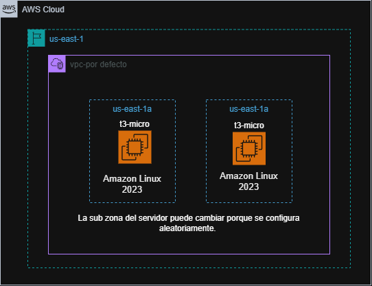

# Ejercicio 1 — Primeras instancias EC2 con Terraform

## Objetivo

Iniciarse en la Infraestructura como Código (IaC) con Terraform creando dos
servidores EC2 en AWS de forma automatizada, reproducible y versionada.

El ejercicio forma parte del repositorio
[Moha591/practiquescloud](https://github.com/Moha591/practiquescloud/tree/main/pt1-4-ex1),
dentro de la carpeta `pt1-4-ex1`.

## Descripción

El archivo [`main.tf`](main.tf) define el proveedor de AWS y dos instancias EC2 con
las siguientes características:

| Parámetro | Valor |
|---|---|
| Tipo de instancia | `t3.micro` |
| Sistema operativo | Amazon Linux 2023 |
| AMI | `ami-04b938437b69a2c9c` (us-east-1) |
| Región | `us-east-1` |
| Número de instancias | 2 (`instanciauno` e `instanciados`) |
| Red | VPC, subred y grupo de seguridad por defecto de la cuenta |
| Acceso remoto | No configurado (sin par de claves) |

## Topología de red



La imagen muestra el camino del tráfico desde Internet hasta las dos instancias:

1. **Internet** llega al **Internet Gateway (IGW)** de la VPC.
2. El IGW está asociado a la **VPC por defecto** (`172.31.0.0/16`).
3. La **tabla de rutas** envía el tráfico `0.0.0.0/0` hacia el IGW.
4. Las instancias se encuentran en la **subred pública por defecto**
   (`172.31.0.0/20`, zona `us-east-1a`).
5. El **grupo de seguridad por defecto** no tiene ninguna regla de entrada, pero
   permite todo el tráfico de salida.

Como `main.tf` no define ningún `subnet_id`, AWS coloca las instancias en una de las
subredes por defecto de la VPC. En el diagrama se muestra `us-east-1a` como ejemplo
de zona de disponibilidad.

El diagrama editable se encuentra en
[`assets/topologia.drawio`](assets/topologia.drawio) y se ha exportado a
[`assets/topologia.png`](assets/topologia.png).

## Estructura del proyecto

```text
pt1-4-ex1/
├── assets/
│   ├── topologia.drawio   # Fuente editable del diagrama (draw.io)
│   └── topologia.png      # Exportación PNG para el README
├── .gitignore             # Excluye el estado y los archivos temporales de Terraform
├── README.md
└── main.tf                # Definición de las 2 instancias EC2
```

## Código desplegado

El contenido principal de `main.tf` es:

```hcl
provider "aws" {
  region = "us-east-1"
}

resource "aws_instance" "instanciauno" {
  ami           = "ami-04b938437b69a2c9c"
  instance_type = "t3.micro"

  tags = {
    Name = "instanciauno"
  }
}

resource "aws_instance" "instanciados" {
  ami           = "ami-04b938437b69a2c9c"
  instance_type = "t3.micro"

  tags = {
    Name = "instanciados"
  }
}
```

## Despliegue

Desde la carpeta del ejercicio:

```bash
cd practiquescloud/pt1-4-ex1

# 1. Descarga el proveedor de AWS y crea el archivo de bloqueo
terraform init

# 2. Comprueba el formato y la sintaxis
terraform fmt -check
terraform validate

# 3. Revisa el plan antes de aplicarlo
terraform plan -out=tfplan

# 4. Crea las instancias
terraform apply tfplan
```

Al terminar, Terraform muestra las dos instancias creadas. El despliegue suele
tardar menos de un minuto.

## Verificación

Con Terraform:

```bash
# Recursos gestionados por el estado
terraform state list

# Detalle del estado y de los atributos de las instancias
terraform show
```

## Limpieza de recursos

Para evitar cargos, destruye las instancias cuando termines:

```bash
terraform plan -destroy
terraform destroy
```

- **Moha591** — [github.com/Moha591](https://github.com/Moha591)
- Repositorio: [github.com/Moha591/practiquescloud](https://github.com/Moha591/practiquescloud)
