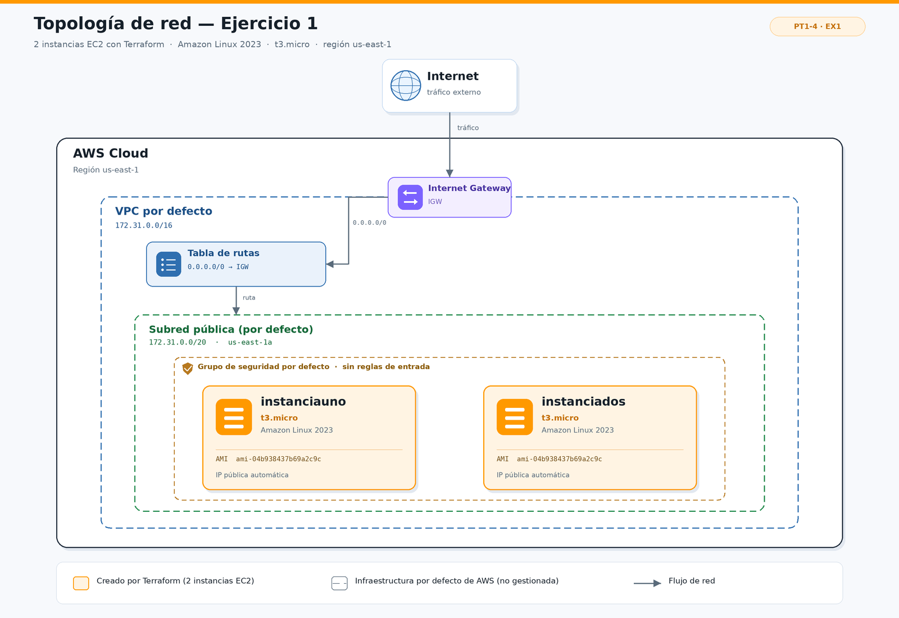

# Ejercicio 1 — Primeras instancias EC2 con Terraform

## Objetivo

Iniciarse en la Infraestructura como Código (IaC) con Terraform creando dos
servidores EC2 en AWS de forma automatizada, reproducible y versionada.

El ejercicio forma parte del repositorio
[Moha591/practiquescloud](https://github.com/Moha591/practiquescloud/tree/main/pt1-4-ex1),
dentro de la carpeta `pt1-4-ex1`.

## Descripción

El archivo [`main.tf`](main.tf) define el proveedor de AWS y dos instancias EC2 con
las siguientes características:

| Parámetro | Valor |
|---|---|
| Tipo de instancia | `t3.micro` |
| Sistema operativo | Amazon Linux 2023 |
| AMI | `ami-04b938437b69a2c9c` (us-east-1) |
| Región | `us-east-1` |
| Número de instancias | 2 (`instanciauno` e `instanciados`) |
| Red | VPC, subred y grupo de seguridad por defecto de la cuenta |
| Acceso remoto | No configurado (sin par de claves) |

## Topología de red



La imagen muestra el camino del tráfico desde Internet hasta las dos instancias:

1. **Internet** llega al **Internet Gateway (IGW)** de la VPC.
2. El IGW está asociado a la **VPC por defecto** (`172.31.0.0/16`).
3. La **tabla de rutas** envía el tráfico `0.0.0.0/0` hacia el IGW.
4. Las instancias se encuentran en la **subred pública por defecto**
   (`172.31.0.0/20`, zona `us-east-1a`).
5. El **grupo de seguridad por defecto** no tiene ninguna regla de entrada, pero
   permite todo el tráfico de salida.

Como `main.tf` no define ningún `subnet_id`, AWS coloca las instancias en una de las
subredes por defecto de la VPC. En el diagrama se muestra `us-east-1a` como ejemplo
de zona de disponibilidad.

> **Nota importante:** Terraform solo crea y gestiona las dos instancias EC2
> (marcadas en naranja). La VPC, la subred, la tabla de rutas, el IGW y el grupo de
> seguridad por defecto ya existen en la cuenta de AWS y no se definen en este
> ejercicio. En el diagrama se representan con líneas discontinuas.

El diagrama editable se encuentra en
[`assets/topologia.drawio`](assets/topologia.drawio) y se ha exportado a
[`assets/topologia.png`](assets/topologia.png).

## Estructura del proyecto

```text
pt1-4-ex1/
├── assets/
│   ├── topologia.drawio   # Fuente editable del diagrama (draw.io)
│   └── topologia.png      # Exportación PNG para el README
├── .gitignore             # Excluye el estado y los archivos temporales de Terraform
├── README.md
└── main.tf                # Definición de las 2 instancias EC2
```

## Código desplegado

El contenido principal de `main.tf` es:

```hcl
provider "aws" {
  region = "us-east-1"
}

resource "aws_instance" "instanciauno" {
  ami           = "ami-04b938437b69a2c9c"
  instance_type = "t3.micro"

  tags = {
    Name = "instanciauno"
  }
}

resource "aws_instance" "instanciados" {
  ami           = "ami-04b938437b69a2c9c"
  instance_type = "t3.micro"

  tags = {
    Name = "instanciados"
  }
}
```

## Requisitos previos

- [Terraform](https://developer.hashicorp.com/terraform/install) 1.3 o superior.
- Una cuenta de AWS con una **VPC por defecto** creada en `us-east-1`.
- Credenciales de AWS configuradas en el sistema. Las opciones habituales son:
  - `aws configure` (perfil `default`), o
  - las variables de entorno `AWS_ACCESS_KEY_ID`, `AWS_SECRET_ACCESS_KEY` y
    `AWS_SESSION_TOKEN` (si se utiliza un entorno temporal).
- Permisos de EC2 para crear, describir y destruir instancias, como
  `ec2:RunInstances`, `ec2:DescribeInstances`, `ec2:TerminateInstances` y
  `ec2:CreateTags`.

Comprueba la identidad y la región antes de desplegar:

```bash
aws sts get-caller-identity
aws configure get region
```

## Despliegue

Desde la carpeta del ejercicio:

```bash
cd practiquescloud/pt1-4-ex1

# 1. Descarga el proveedor de AWS y crea el archivo de bloqueo
terraform init

# 2. Comprueba el formato y la sintaxis
terraform fmt -check
terraform validate

# 3. Revisa el plan antes de aplicarlo
terraform plan -out=tfplan

# 4. Crea las instancias
terraform apply tfplan
```

Al terminar, Terraform muestra las dos instancias creadas. El despliegue suele
tardar menos de un minuto.

## Verificación

Con Terraform:

```bash
# Recursos gestionados por el estado
terraform state list

# Detalle del estado y de los atributos de las instancias
terraform show
```

Con AWS CLI:

```bash
aws ec2 describe-instances \
  --region us-east-1 \
  --filters "Name=tag:Name,Values=instanciauno,instanciados" \
  --query "Reservations[].Instances[].{Nombre:Tags[?Key=='Name']|[0].Value,ID:InstanceId,Estado:State.Name,IP:PublicIpAddress,Tipo:InstanceType" \
  --output table
```

También se pueden consultar en la consola de AWS: **EC2 → Instancias**, filtrando
por las etiquetas `Name = instanciauno` y `Name = instanciados`.

## Limpieza de recursos

Para evitar cargos, destruye las instancias cuando termines:

```bash
terraform plan -destroy
terraform destroy
```

Confirma la destrucción escribiendo `yes`. Una vez finalizado, comprueba que ya no
queda ninguna instancia con estas etiquetas:

```bash
aws ec2 describe-instances \
  --region us-east-1 \
  --filters "Name=tag:Name,Values=instanciauno,instanciados" \
  --query "Reservations[].Instances[].State.Name"
```

## Decisiones técnicas y limitaciones

- **Región única:** todo se despliega en `us-east-1` para simplificar el ejercicio
  y coincidir con la AMI indicada.
- **Sin par de claves:** no se ha definido `key_name`, por lo que no se puede
  acceder por SSH a las instancias. Tampoco es necesario para el objetivo del
  ejercicio, que es practicar la creación de recursos con Terraform.
- **Grupo de seguridad por defecto:** no tiene reglas de entrada; el tráfico de
  salida sí está permitido. Si se quisiera SSH, habría que crear un grupo de
  seguridad con el puerto 22 abierto (mejor, limitado a una IP concreta) y un par
  de claves.
- **IP pública:** en la VPC por defecto, las subredes tienen activada por defecto la
  asignación automática de IP pública, por lo que las instancias reciben una IP
  pública. Esto no implica que sean accesibles, porque el grupo de seguridad bloquea
  la entrada.
- **AMI fijada:** el ID `ami-04b938437b69a2c9c` corresponde a una imagen de Amazon
  Linux 2023 de `us-east-1`. Las AMI se van actualizando y el ID puede quedar
  obsoleto. Si `terraform plan` devuelve `InvalidAMIID.NotFound`, hay que consultar
  la AMI vigente.
- **Estado local:** este ejercicio utiliza el estado local de Terraform
  (`terraform.tfstate`). No se debe versionar porque puede contener información de
  la cuenta. Para un entorno de equipo o producción se recomienda un backend
  remoto, como S3 con bloqueo en DynamoDB.
- **Coste:** `t3.micro` puede estar cubierto por el nivel gratuito durante los
  primeros 12 meses, pero dos instancias encendidas 24/7 pueden superar las 750
  horas mensuales gratuitas. Las IP públicas y los volúmenes EBS también pueden
  generar cargos.

## Mejoras opcionales

- **Evitar una AMI hardcodeada** con un `data source` que seleccione siempre la
  última Amazon Linux 2023:

  ```hcl
  data "aws_ami" "al2023" {
    most_recent = true
    owners      = ["amazon"]

    filter {
      name   = "name"
      values = ["al2023-ami-2023.*-x86_64"]
    }

    filter {
      name   = "virtualization-type"
      values = ["hvm"]
    }
  }
  ```

  Después, en cada `aws_instance`, se puede usar `ami = data.aws_ami.al2023.id`.

- **Parametrizar** el tipo de instancia, la región y el número de instancias con
  variables (`variable` + `terraform.tfvars`).
- **Añadir outputs** con los IDs y las IPs públicas de las instancias.
- **Crear una VPC propia** con subredes, tabla de rutas, IGW y grupo de seguridad,
  en lugar de depender de la VPC por defecto.
- **Fijar la versión del proveedor** con un bloque `required_providers` y un
  `terraform.lock.hcl` versionado.

## Autor

- **Moha591** — [github.com/Moha591](https://github.com/Moha591)
- Repositorio: [github.com/Moha591/practiquescloud](https://github.com/Moha591/practiquescloud)
