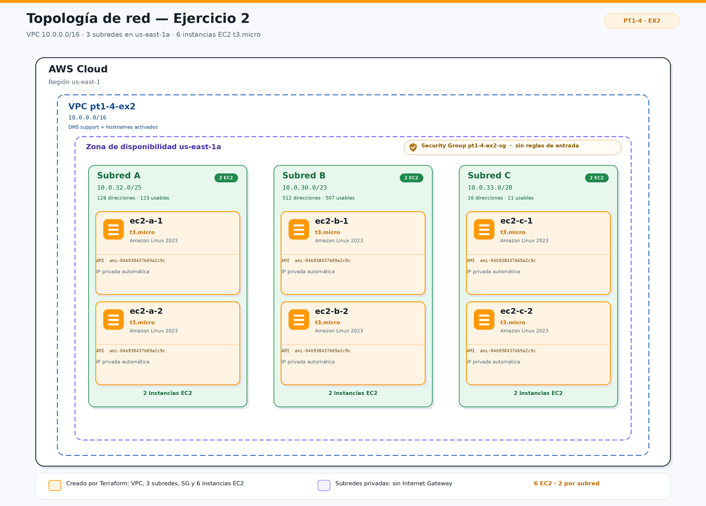
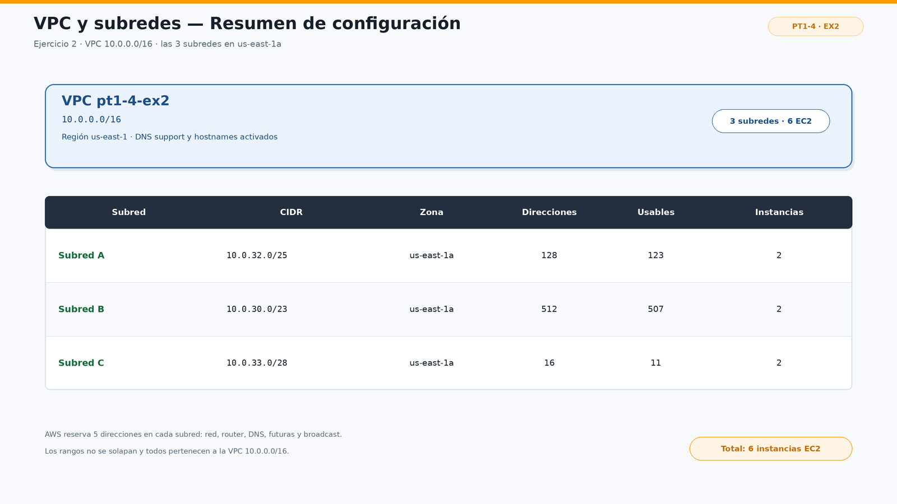
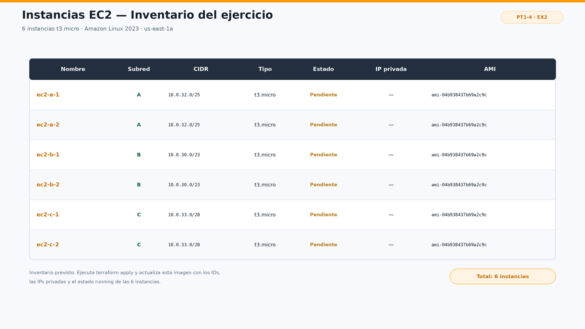

# Ejercicio 2 — Diseño y despliegue de VPC, subredes y EC2 (Consola + IaC)

## Objetivo

Comprender la segmentación de redes en AWS mediante una VPC con tres subredes y
comparar dos formas de despliegue:

- **Parte B:** despliegue manual desde la consola de AWS.
- **Parte C:** despliegue automatizado con Terraform (IaC).

Las tres subredes se encuentran en la misma zona de disponibilidad (`us-east-1a`) y
en cada una se despliegan dos instancias EC2 `t3.micro` con Amazon Linux 2023, hasta
un total de **6 instancias**.

## Diseño de red

| Subred | CIDR | Zona | Direcciones | Usables | Instancias |
|---|---|---|---|---|---|
| Subred A | `10.0.32.0/25` | `us-east-1a` | 128 | 123 | 2 |
| Subred B | `10.0.30.0/23` | `us-east-1a` | 512 | 507 | 2 |
| Subred C | `10.0.33.0/28` | `us-east-1a` | 16 | 11 | 2 |
| **Total** | **VPC `10.0.0.0/16`** | | | | **6** |

AWS reserva 5 direcciones en cada subred (red, router, DNS, futuras y broadcast), por
eso el número de direcciones usables es el total menos cinco.

Los rangos no se solapan:

- Subred A: `10.0.32.0` — `10.0.32.127`
- Subred B: `10.0.30.0` — `10.0.31.255`
- Subred C: `10.0.33.0` — `10.0.33.15`

Todos los rangos pertenecen a la VPC `10.0.0.0/16`.

## Topología



La VPC contiene una única zona de disponibilidad (`us-east-1a`) con las tres subredes.
Cada subred aloja dos instancias EC2, todas con el mismo security group
(`pt1-4-ex2-sg`), que no tiene reglas de entrada.

El diagrama editable se encuentra en
[`assets/topologia.drawio`](assets/topologia.drawio) y se ha exportado a
[`assets/topologia.png`](assets/topologia.png).

## Parte A — Diseño de la red

La VPC y las subredes se han diseñado con los siguientes criterios:

- Una VPC principal con bloque `10.0.0.0/16`.
- Tres subredes de tamaños diferentes para practicar el cálculo de CIDR.
- Las tres subredes en la misma AZ (`us-east-1a`), tal como pide el enunciado.
- Dos instancias EC2 por subred, con un total de seis.
- Sin solapamientos entre subredes.

## Parte B — Despliegue por consola de AWS

El despliegue manual se realiza desde la consola de AWS con estos pasos:

1. **Crear la VPC:** `VPC → Your VPCs → Create VPC`, seleccionando solo la VPC
   (sin subredes automáticas), con nombre `pt1-4-ex2-vpc` y CIDR `10.0.0.0/16`.
2. **Crear las subredes:** `VPC → Subnets → Create subnet`, seleccionando la VPC
   anterior, la AZ `us-east-1a` y los CIDR `10.0.32.0/25`, `10.0.30.0/23` y
   `10.0.33.0/28`.
3. **Crear las instancias:** `EC2 → Instances → Launch instances`, con Amazon Linux
   2023, tipo `t3.micro`, la VPC y la subred correspondiente. Se crean dos instancias
   por subred, sin par de claves y con el security group del ejercicio.
4. **Etiquetar los recursos** con `Project = pt1-4-ex2` para poder filtrarlos.
5. **Tomar las capturas** de la VPC, las subredes y el listado de las seis instancias.

### Resumen de la VPC y las subredes



### Inventario de las instancias EC2



> **Nota:** las dos imágenes anteriores son resúmenes de la configuración creada.
> Para la entrega final, sustitúyelas por capturas reales de la consola de AWS
> (`VPC → Your VPCs`, `VPC → Subnets` y `EC2 → Instances`) una vez desplegada la
> infraestructura.

## Parte C — Despliegue con Terraform

### Estructura del proyecto

```text
pt1-4-ex2/
├── assets/
│   ├── topologia.drawio       # Fuente editable del diagrama (draw.io)
│   ├── topologia.png          # Diagrama de topología
│   ├── vpc_subnets.png        # Resumen de la VPC y las subredes
│   └── ec2_instances.png      # Inventario de las 6 instancias
├── .gitignore                 # Excluye estado y archivos temporales de Terraform
├── .terraform.lock.hcl        # Versiones fijadas del proveedor de AWS
├── README.md
├── main.tf                    # VPC, subredes, security group y 6 EC2
├── variables.tf               # Variables del proyecto
├── outputs.tf                 # IDs, IPs y resumen de las instancias
└── terraform.tfvars.example   # Ejemplo de valores para terraform.tfvars
```

### Configuración principal

`main.tf` declara el proveedor de AWS, la VPC, las subredes, el security group y las
seis instancias:

```hcl
terraform {
  required_version = ">= 1.3.0"

  required_providers {
    aws = {
      source  = "hashicorp/aws"
      version = "~> 6.0"
    }
  }
}

provider "aws" {
  region = var.aws_region
}

resource "aws_vpc" "this" {
  cidr_block           = var.vpc_cidr
  enable_dns_support   = true
  enable_dns_hostnames = true

  tags = {
    Name    = "pt1-4-ex2-vpc"
    Project = "pt1-4-ex2"
  }
}
```

Las subredes se crean con `for_each` a partir del mapa definido en `variables.tf`:

```hcl
resource "aws_subnet" "this" {
  for_each = var.subnets

  vpc_id                  = aws_vpc.this.id
  cidr_block              = each.value.cidr_block
  availability_zone       = var.availability_zone
  map_public_ip_on_launch = false

  tags = {
    Name    = "pt1-4-ex2-${each.value.name}"
    Project = "pt1-4-ex2"
    Subnet  = each.key
  }
}
```

Las seis instancias también se generan con `for_each`, asignando dos a cada subred:

```hcl
locals {
  instances = {
    "ec2-a-1" = "A"
    "ec2-a-2" = "A"
    "ec2-b-1" = "B"
    "ec2-b-2" = "B"
    "ec2-c-1" = "C"
    "ec2-c-2" = "C"
  }
}

resource "aws_instance" "this" {
  for_each = local.instances

  ami                         = var.ami_id
  instance_type               = var.instance_type
  subnet_id                   = aws_subnet.this[each.value].id
  vpc_security_group_ids      = [aws_security_group.this.id]
  associate_public_ip_address = false

  tags = {
    Name    = "pt1-4-ex2-${each.key}"
    Project = "pt1-4-ex2"
    Subnet  = each.value
  }
}
```

### Variables

| Variable | Valor por defecto | Descripción |
|---|---|---|
| `aws_region` | `us-east-1` | Región de AWS |
| `vpc_cidr` | `10.0.0.0/16` | CIDR de la VPC |
| `availability_zone` | `us-east-1a` | AZ común a las subredes |
| `ami_id` | `ami-04b938437b69a2c9c` | AMI de Amazon Linux 2023 |
| `instance_type` | `t3.micro` | Tipo de instancia |
| `subnets` | A/B/C con sus CIDR | Mapa de subredes |

La AMI es la misma que se utiliza en `pt1-4-ex1`.

### Outputs

`outputs.tf` expone:

- `vpc_id` y `vpc_cidr`.
- `subnet_ids` y `subnet_cidrs`, indexados por `A`, `B` y `C`.
- `security_group_id`.
- `instance_ids` e `instance_private_ips`, indexados por nombre.
- `instance_summary`, con ID, IP privada, subred, estado y tipo de cada instancia.

## Despliegue

Desde la carpeta del ejercicio:

```bash
cd practiquescloud/pt1-4-ex2

# 1. Descarga el proveedor y crea el archivo de bloqueo
terraform init

# 2. Comprueba formato y sintaxis
terraform fmt -check
terraform validate

# 3. Revisa el plan
terraform plan -out=tfplan

# 4. Crea la VPC, las subredes, el security group y las 6 instancias
terraform apply tfplan
```

Si se quiere personalizar algún valor:

```bash
cp terraform.tfvars.example terraform.tfvars
# editar terraform.tfvars
terraform plan -out=tfplan
terraform apply tfplan
```

Al finalizar, consulta los resultados:

```bash
terraform output
terraform output instance_summary
terraform output instance_private_ips
```

## Verificación

Con Terraform:

```bash
terraform state list
terraform show
```

Con AWS CLI:

```bash
aws ec2 describe-instances \
  --region us-east-1 \
  --filters "Name=tag:Project,Values=pt1-4-ex2" \
  --query "Reservations[].Instances[].{Nombre:Tags[?Key=='Name']|[0].Value,ID:InstanceId,Estado:State.Name,Tipo:InstanceType,Subred:SubnetId,IPPrivada:PrivateIpAddress}" \
  --output table
```

También se pueden consultar en la consola:

- **VPC → Your VPCs** para ver `pt1-4-ex2-vpc`.
- **VPC → Subnets** para ver las tres subredes.
- **EC2 → Instances** filtrando por `Project = pt1-4-ex2` para ver las seis instancias.

## Limpieza de recursos

Para evitar cargos, destruye toda la infraestructura cuando termines:

```bash
terraform plan -destroy
terraform destroy
```

Confirma la destrucción escribiendo `yes`. El `destroy` elimina las seis instancias,
el security group, las subredes y la VPC.

## Comparación: consola vs. Terraform

| Aspecto | Consola de AWS | Terraform |
|---|---|---|
| Velocidad inicial | Rápida para pocos recursos | Requiere escribir el código |
| Reproducibilidad | Manual, depende de los pasos | Alta, el código se repite |
| Errores humanos | Fáciles de cometer | Menores, validados con `plan` |
| Versionado | No | Sí, en Git |
| Cambios | Manuales | `terraform plan` + `apply` |
| Documentación | Capturas de pantalla | Código y README |
| Eliminación | Manual, recurso a recurso | `terraform destroy` |

## Decisiones técnicas y limitaciones

- **Misma AZ:** las tres subredes están en `us-east-1a` para cumplir el enunciado.
- **Subredes privadas:** no se crea Internet Gateway, tabla de rutas pública ni NAT.
  Las instancias no tienen IP pública y el security group no tiene reglas de entrada.
  Esto es suficiente para el objetivo de segmentación del ejercicio.
- **Sin par de claves:** no se ha definido `key_name`; no se puede acceder por SSH.
- **AMI fijada:** el ID `ami-04b938437b69a2c9c` corresponde a una AMI de Amazon Linux
  2023 de `us-east-1`. Las AMI se actualizan y el ID puede quedar obsoleto. Si
  `terraform plan` devuelve `InvalidAMIID.NotFound`, hay que consultar la AMI vigente
  o usar un `data source`.
- **Estado local:** se utiliza `terraform.tfstate` local. No debe versionarse. Para un
  entorno de equipo se recomienda un backend remoto, como S3 con bloqueo en DynamoDB.
- **Coste:** seis instancias `t3.micro` encendidas 24/7 pueden superar el nivel
  gratuito. Hay que ejecutar `terraform destroy` al terminar.
- **Security group:** se crea un grupo propio (`pt1-4-ex2-sg`) con salida permitida y
  sin entrada. Las instancias no son accesibles desde Internet.

## Mejoras opcionales

- Añadir un **Internet Gateway** y una tabla de rutas para convertir las subredes en
  públicas, con las reglas de security group necesarias.
- Añadir un **NAT Gateway** si se quieren subredes privadas con salida a Internet.
- Usar **AWS Systems Manager** en lugar de SSH, con un rol de IAM y el agente SSM.
- Convertir la infraestructura en **módulos** reutilizables.
- Añadir **validaciones de CIDR** en las variables.
- Usar un **backend remoto** para el estado de Terraform.
- Añadir un **Application Load Balancer** y un Auto Scaling Group como siguiente paso.

## Autor

- **Moha591** — [github.com/Moha591](https://github.com/Moha591)
- Repositorio: [github.com/Moha591/practiquescloud](https://github.com/Moha591/practiquescloud)
