# Ejercicio 2 — Diseño y despliegue de VPC, subredes y EC2

## Objetivo

Comprender la segmentación de redes en AWS mediante una VPC con tres subredes y
comparar dos formas de despliegue:

- **Parte B:** despliegue manual desde la consola de AWS.
- **Parte C:** despliegue automatizado con Terraform.

Las tres subredes se encuentran en la misma zona de disponibilidad (`us-east-1a`) y
en cada una se despliegan dos instancias EC2 `t3.micro` con Amazon Linux 2023, hasta
un total de **6 instancias**.

El diseño es de subredes privadas: no se asigna IP pública a las instancias y no se
declara Internet Gateway ni tabla de rutas hacia Internet.

## Diseño de red

| Subred | CIDR | Zona | Instancias |
|---|---|---|---|
| Subred A | `10.0.32.0/25` | `us-east-1a` | 2 |
| Subred B | `10.0.30.0/23` | `us-east-1a` | 2 |
| Subred C | `10.0.33.0/28` | `us-east-1a` | 2 |
| **Total** | **VPC `10.0.0.0/16`** | | **6** |

Los rangos no se solapan:

- Subred A: `10.0.32.0` — `10.0.32.127`
- Subred B: `10.0.30.0` — `10.0.31.255`
- Subred C: `10.0.33.0` — `10.0.33.15`

Todas las subredes pertenecen a la VPC `10.0.0.0/16` y están en `us-east-1a`.

## Topología

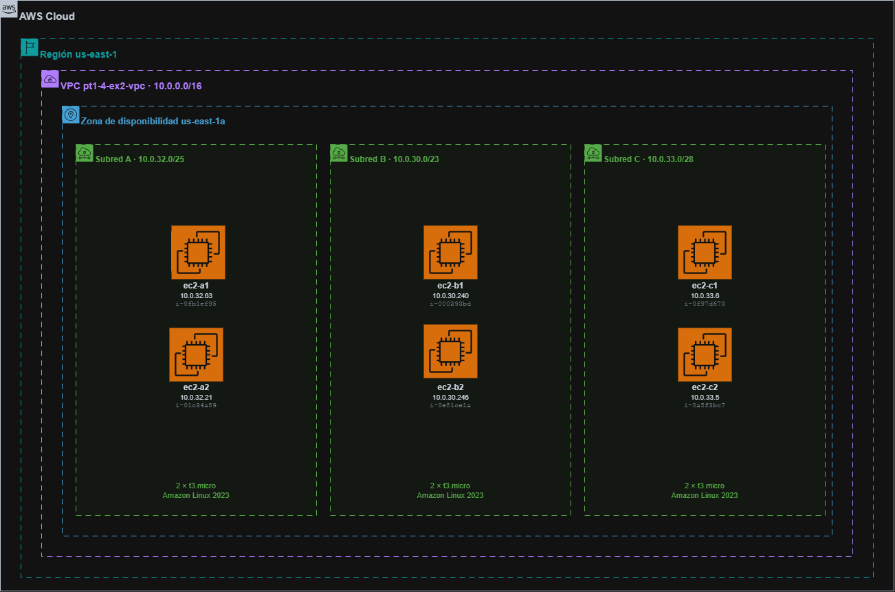

## Despliegue manual en la consola de AWS

El despliegue manual se realiza **íntegramente desde la consola de AWS**, sin
utilizar la terminal.

### 1. Crear la VPC

Ir a **VPC → Your VPCs → Create VPC**:

- Nombre: `pt1-4-ex2-vpc`.
- Bloque IPv4 CIDR: `10.0.0.0/16`.
- Sin subredes automáticas, sin Internet Gateway.

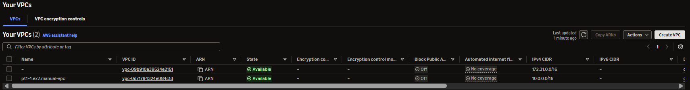

### 2. Crear las subredes

Ir a **VPC → Subnets → Create subnet**, seleccionar la VPC `pt1-4-ex2-vpc` y crear
tres subredes en la zona `us-east-1a`:

- `pt1-4-ex2-subnet-a` → `10.0.32.0/25`
- `pt1-4-ex2-subnet-b` → `10.0.30.0/23`
- `pt1-4-ex2-subnet-c` → `10.0.33.0/28`

En **Actions → Modify auto-assign IP settings** de cada subred, dejar
**Auto-assign public IPv4 = Disable** (son subredes privadas).

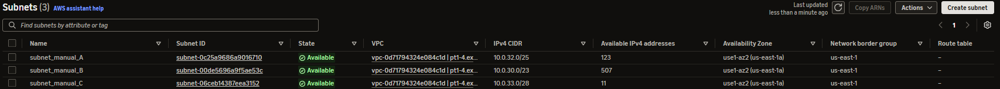

Detalle de cada subred:

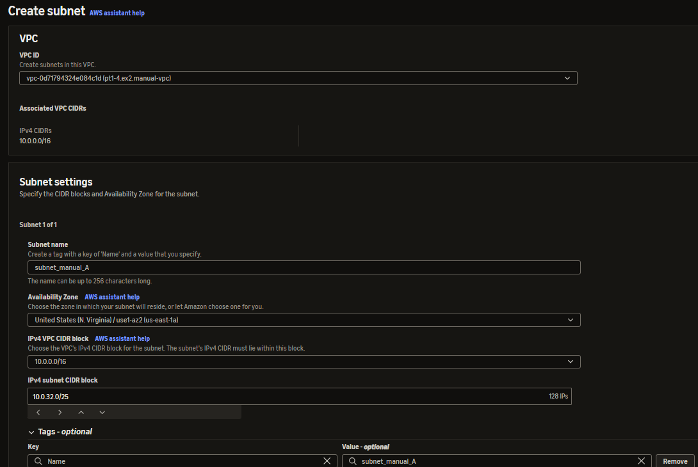

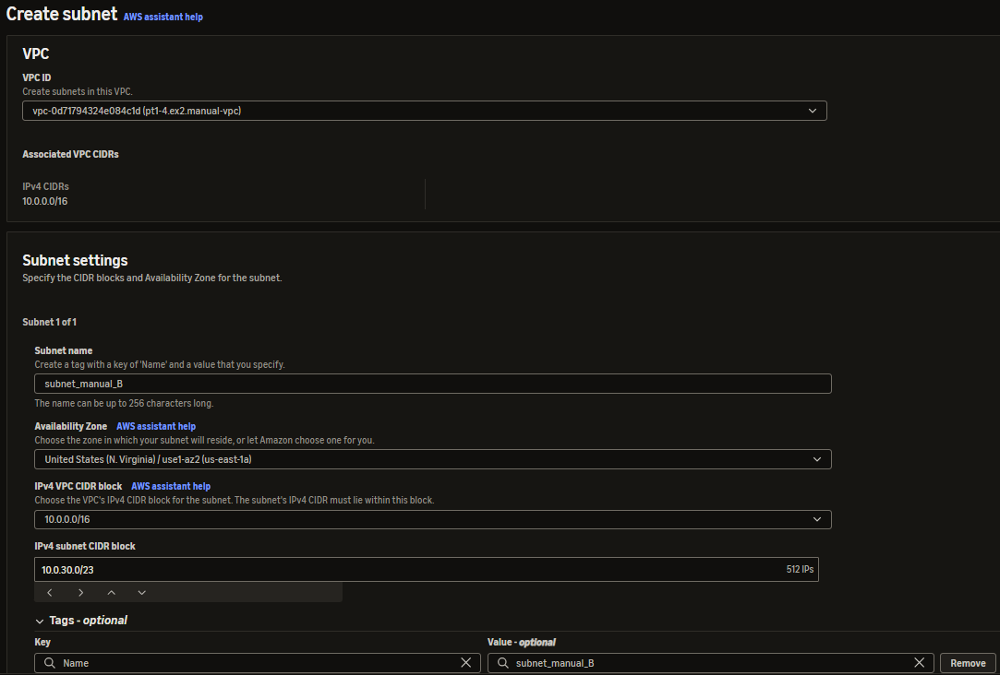


### 3. Lanzar las instancias EC2

Ir a **EC2 → Instances → Launch instances**. Como ejemplo se muestra el proceso
completo para crear la primera instancia (`a1`); el resto (`a2`, `b1`, `b2`, `c1`,
`c2`) siguen exactamente los mismos pasos, cambiando solo el nombre y la subred.

**Parte 1 — Configuración inicial de la instancia `pt1-4-ex2-a1`:**

- Nombre: `pt1-4-ex2-a1`.
- AMI: **Amazon Linux 2023 (x86_64)**.
- Tipo de instancia: `t3.micro`.
- Par de claves: el disponible en el laboratorio (`vockey`).
- Red: VPC `pt1-4-ex2-vpc` y subred `pt1-4-ex2-subnet-a`.
- **No** marcar la opción de asignar IP pública (subred privada).

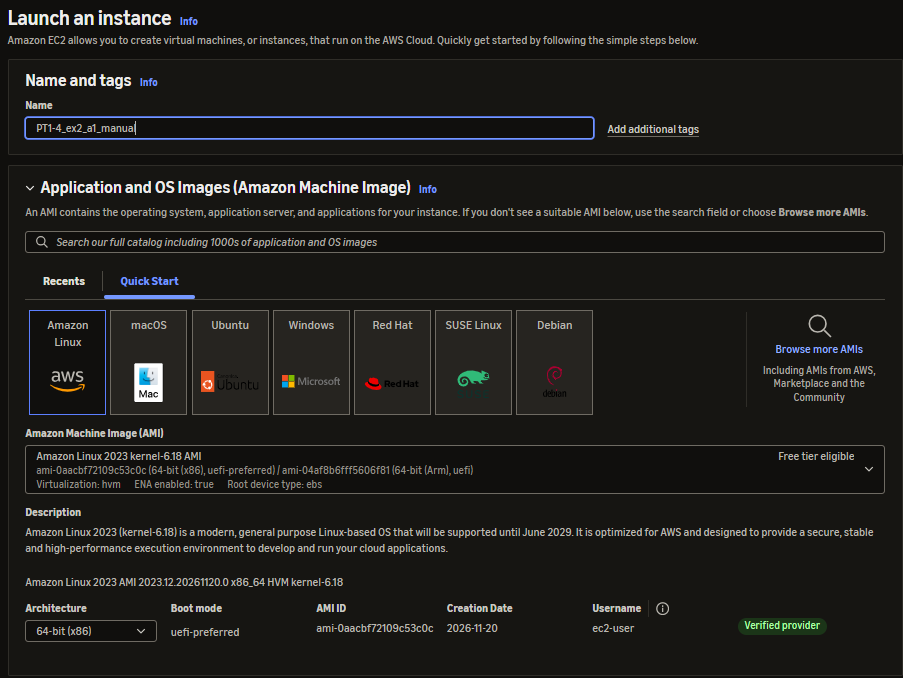

**Parte 2 — Revisión y lanzamiento de la instancia `pt1-4-ex2-a1`:**

- Revisar el resumen de configuración.
- Pulsar **Launch instance**.


Una vez creada la primera, se repite el proceso para las otras cinco instancias,
asignando a cada una su subred correspondiente:

| Instancia | Subred |
|---|---|
| `pt1-4-ex2-a1` | `pt1-4-ex2-subnet-a` |
| `pt1-4-ex2-a2` | `pt1-4-ex2-subnet-a` |
| `pt1-4-ex2-b1` | `pt1-4-ex2-subnet-b` |
| `pt1-4-ex2-b2` | `pt1-4-ex2-subnet-b` |
| `pt1-4-ex2-c1` | `pt1-4-ex2-subnet-c` |
| `pt1-4-ex2-c2` | `pt1-4-ex2-subnet-c` |

Detalle de cada instancia creada:

**Instancia `pt1-4-ex2-a1`** (subred `pt1-4-ex2-subnet-a`)

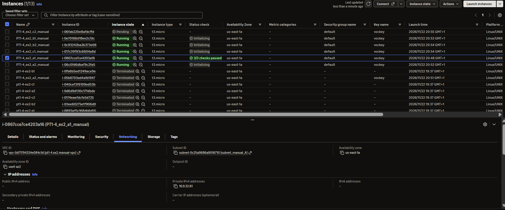

**Instancia `pt1-4-ex2-a2`** (subred `pt1-4-ex2-subnet-a`)

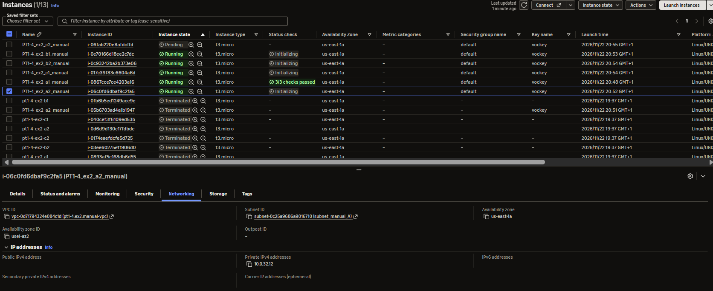

**Instancia `pt1-4-ex2-b1`** (subred `pt1-4-ex2-subnet-b`)


**Instancia `pt1-4-ex2-b2`** (subred `pt1-4-ex2-subnet-b`)

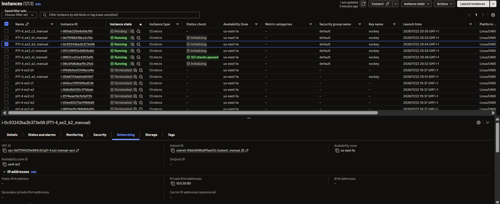

**Instancia `pt1-4-ex2-c1`** (subred `pt1-4-ex2-subnet-c`)

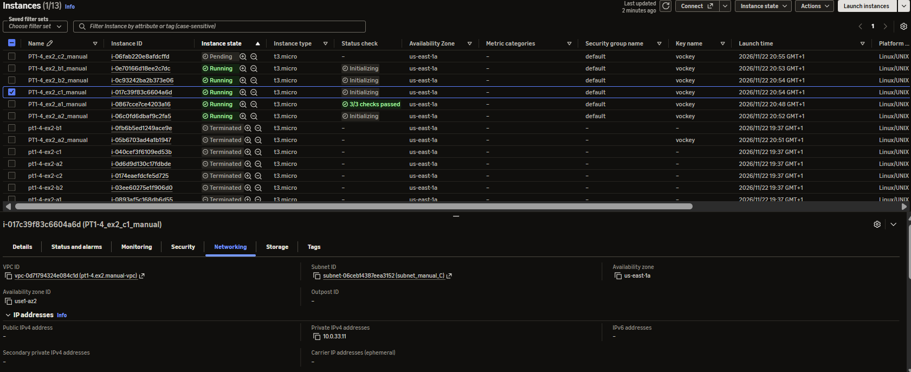

**Instancia `pt1-4-ex2-c2`** (subred `pt1-4-ex2-subnet-c`)

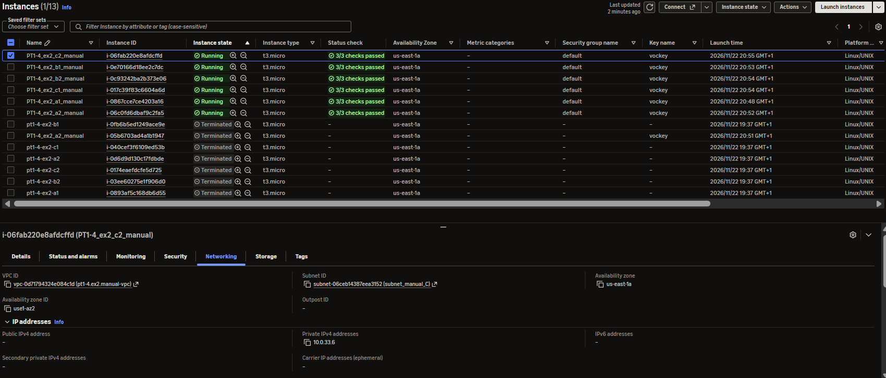

### 4. Comprobar el resultado

En **EC2 → Instances** se verifica que las seis instancias están en estado
`Running`, cada una en su subred, con IP privada dentro del rango de su subred y
**sin IP pública**.


## Despliegue con Terraform

### Estructura del proyecto

```text
pt1-4-ex2/
├── assets/
│   ├── topologia.drawio
│   ├── topologia.drawio.png
│   ├── vpc_teraform.png
│   ├── subnet_teraform.png
│   └── instancias_teraform.png
├── main.tf
└── README.md
```

### Código Terraform

`main.tf` declara explícitamente la VPC, las tres subredes y las seis instancias.
Cada instancia tiene asignada su subred mediante `subnet_id`.

```hcl
terraform {
  required_version = ">= 1.3.0"

  required_providers {
    aws = {
      source  = "hashicorp/aws"
      version = "~> 6.0"
    }
  }
}

provider "aws" {
  region = "us-east-1"
}

# ---------------------------------------------------------------------------
# Red
# ---------------------------------------------------------------------------
resource "aws_vpc" "this" {
  cidr_block = "10.0.0.0/16"

  tags = {
    Name = "pt1-4-ex2-vpc"
  }
}

# ---------------------------------------------------------------------------
# Subredes
# ---------------------------------------------------------------------------
resource "aws_subnet" "a" {
  vpc_id            = aws_vpc.this.id
  cidr_block        = "10.0.32.0/25"
  availability_zone = "us-east-1a"

  tags = {
    Name = "pt1-4-ex2-subnet-a"
  }
}

resource "aws_subnet" "b" {
  vpc_id            = aws_vpc.this.id
  cidr_block        = "10.0.30.0/23"
  availability_zone = "us-east-1a"

  tags = {
    Name = "pt1-4-ex2-subnet-b"
  }
}

resource "aws_subnet" "c" {
  vpc_id            = aws_vpc.this.id
  cidr_block        = "10.0.33.0/28"
  availability_zone = "us-east-1a"

  tags = {
    Name = "pt1-4-ex2-subnet-c"
  }
}

# ---------------------------------------------------------------------------
# Instancias EC2: 2 por subred
# ---------------------------------------------------------------------------
resource "aws_instance" "a1" {
  ami           = "ami-04b938437b69a2c9c"
  instance_type = "t3.micro"
  subnet_id     = aws_subnet.a.id

  tags = {
    Name = "pt1-4-ex2-a1"
  }
}

resource "aws_instance" "a2" {
  ami           = "ami-04b938437b69a2c9c"
  instance_type = "t3.micro"
  subnet_id     = aws_subnet.a.id

  tags = {
    Name = "pt1-4-ex2-a2"
  }
}

resource "aws_instance" "b1" {
  ami           = "ami-04b938437b69a2c9c"
  instance_type = "t3.micro"
  subnet_id     = aws_subnet.b.id

  tags = {
    Name = "pt1-4-ex2-b1"
  }
}

resource "aws_instance" "b2" {
  ami           = "ami-04b938437b69a2c9c"
  instance_type = "t3.micro"
  subnet_id     = aws_subnet.b.id

  tags = {
    Name = "pt1-4-ex2-b2"
  }
}

resource "aws_instance" "c1" {
  ami           = "ami-04b938437b69a2c9c"
  instance_type = "t3.micro"
  subnet_id     = aws_subnet.c.id

  tags = {
    Name = "pt1-4-ex2-c1"
  }
}

resource "aws_instance" "c2" {
  ami           = "ami-04b938437b69a2c9c"
  instance_type = "t3.micro"
  subnet_id     = aws_subnet.c.id

  tags = {
    Name = "pt1-4-ex2-c2"
  }
}
```
### Despliegue

```bash
terraform init
terraform fmt -check
terraform validate
terraform plan -out=tfplan
terraform apply tfplan
```

## Resultados del despliegue Terraform

### Capturas del despliegue con Terraform


