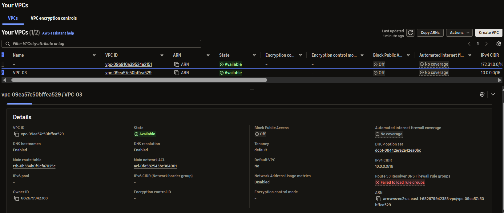
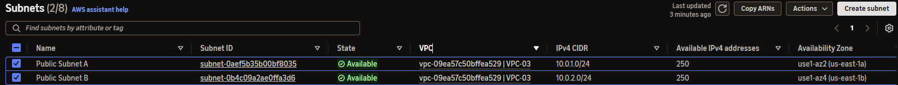
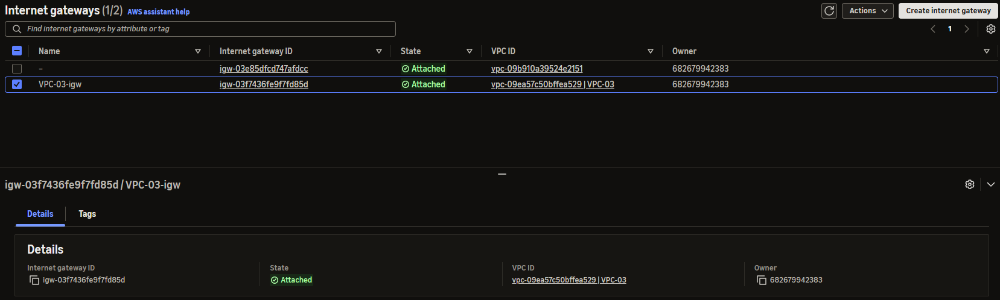
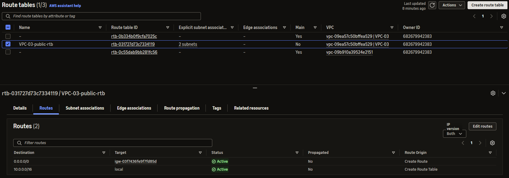
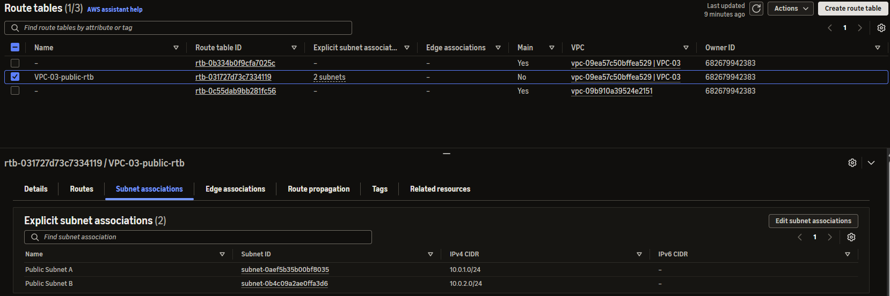
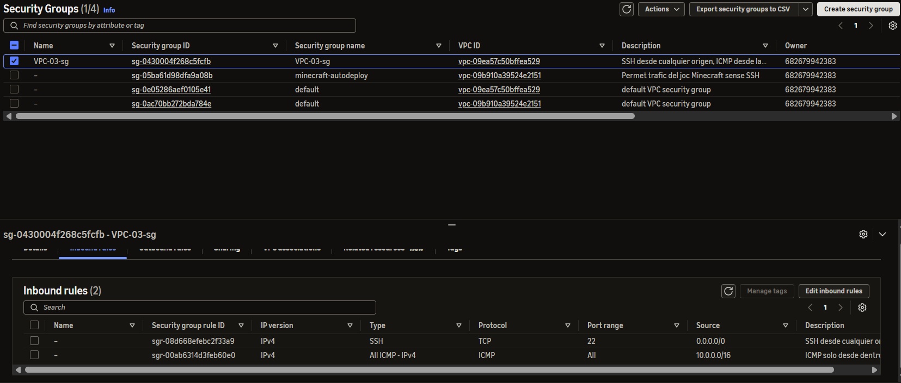
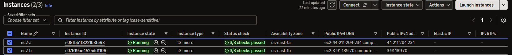
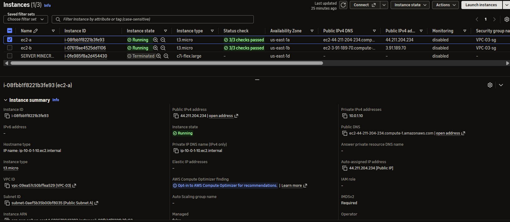
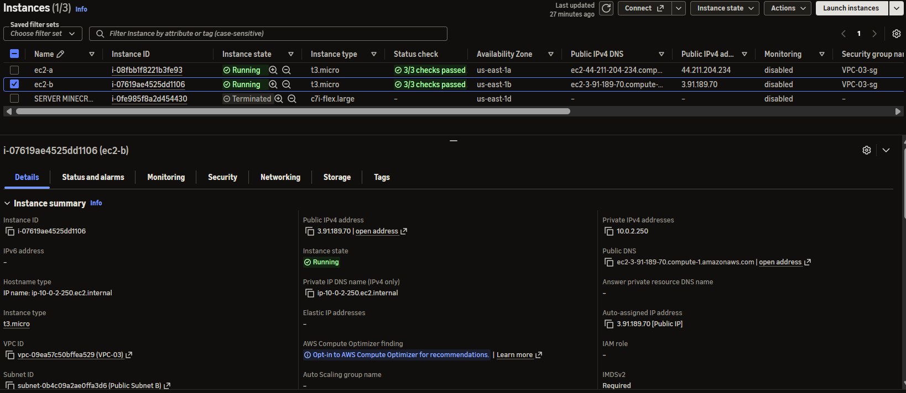

# Pt2.2 — IGW, RTB i SG

## Objetivo

Crear con Terraform una infraestructura básica en AWS compuesta por una VPC, dos
subredes públicas, un Internet Gateway, una tabla de rutas pública, un Security Group
y dos instancias EC2, siguiendo los requisitos de la práctica **Pt2.2**.

## Arquitectura

| Recurso | Nombre | Configuración |
|---|---|---|
| Región | — | `us-east-1` |
| VPC | `VPC-03` | `10.0.0.0/16` |
| Subred pública A | `Public Subnet A` | `10.0.1.0/24`, `us-east-1a`, IP pública automática |
| Subred pública B | `Public Subnet B` | `10.0.2.0/24`, `us-east-1b`, IP pública automática |
| Internet Gateway | `VPC-03-igw` | Asociado a `VPC-03` |
| Tabla de rutas | `VPC-03-public-rtb` | `0.0.0.0/0` → Internet Gateway |
| Security Group | `VPC-03-sg` | SSH, ICMP y salida |
| Instancia A | `ec2-a` | `t3.micro`, Amazon Linux, `Public Subnet A`, clave `vockey` |
| Instancia B | `ec2-b` | `t3.micro`, Amazon Linux, `Public Subnet B`, clave `vockey` |

### Reglas del Security Group

| Dirección | Protocolo / puerto | Origen / destino | Descripción |
|---|---|---|---|
| Entrada | TCP `22` | `0.0.0.0/0` | SSH desde cualquier origen |
| Entrada | ICMP (`-1`) | `10.0.0.0/16` | Ping solo desde dentro de la VPC |
| Salida | Todos (`-1`) | `0.0.0.0/0` | Todo el tráfico saliente |

## Estructura del proyecto

```text
pt2-2/
├── assets/
│   ├── ec2_instances.png
│   ├── ec2_instances_ec2-a.png
│   ├── ec2_instances_ec2-b.png
│   ├── igw.png
│   ├── route_table_asociaciones.png
│   ├── route_table_routes.png
│   ├── security_group.png
│   ├── subnet.png
│   └── vpc.png
├── .gitignore
├── README.md
├── main.tf                  # VPC, subredes, IGW, RTB, SG e instancias EC2
├── outputs.tf               # IDs e IPs públicas de los recursos
├── terraform.tfvars.example # Ejemplo de variables locales
├── variables.tf             # Variables con valores por defecto
└── versions.tf              # Versión de Terraform y proveedor AWS
```

## Despliegue

Desde la carpeta `pt2-2`:

```bash
cd /mnt/c/Users/marti/Desktop/Claud/practiquescloud/practiquescloud/pt2-2
export PATH="$HOME/.local/bin:$HOME/.local/venvs/aws/bin:$PATH"

# 1. Descargar el proveedor de AWS
terraform init

# 2. Comprobar formato y sintaxis
terraform fmt -check
terraform validate

# 3. Revisar el plan
terraform plan -out=tfplan

# 4. Crear la infraestructura
terraform apply tfplan

# 5. Ver los IDs e IPs creados
terraform output
```

## Resultados del despliegue

Infraestructura desplegada y verificada en `us-east-1`:

| Recurso | ID | Detalle |
|---|---|---|
| VPC | `vpc-09ea57c50bffea529` | `VPC-03`, `10.0.0.0/16` |
| Public Subnet A | `subnet-0aef5b35b00bf8035` | `10.0.1.0/24`, `us-east-1a` |
| Public Subnet B | `subnet-0b4c09a2ae0ffa3d6` | `10.0.2.0/24`, `us-east-1b` |
| Internet Gateway | `igw-03f7436fe9f7fd85d` | Asociado a `VPC-03` |
| Tabla de rutas | `rtb-031727d73c7334119` | `0.0.0.0/0` → IGW |
| Security Group | `sg-0430004f268c5fcfb` | `VPC-03-sg` |

| Instancia | ID | Subred | AZ | IP privada | IP pública | Estado |
|---|---|---|---|---|---|---|
| `ec2-a` | `i-08fbb1f8221b3fe93` | Public Subnet A | `us-east-1a` | `10.0.1.10` | `44.211.204.234` | `running` |
| `ec2-b` | `i-07619ae4525dd1106` | Public Subnet B | `us-east-1b` | `10.0.2.250` | `3.91.189.70` | `running` |

## Capturas de la infraestructura

### VPC



### Subredes públicas



### Internet Gateway



### Tabla de rutas

Ruta por defecto hacia el Internet Gateway:



Asociación de la tabla de rutas con las dos subredes:



### Security Group



### Instancias EC2



Detalle de `ec2-a`:



Detalle de `ec2-b`:



  excluidos por `.gitignore`.
- La infraestructura ya está desplegada y verificada. Las credenciales de AWS Academy
  son temporales: si caducan, hay que volver a copiarlas desde el Learner Lab.
- Ejecutar `terraform destroy` cuando se terminen las capturas para evitar cargos.
